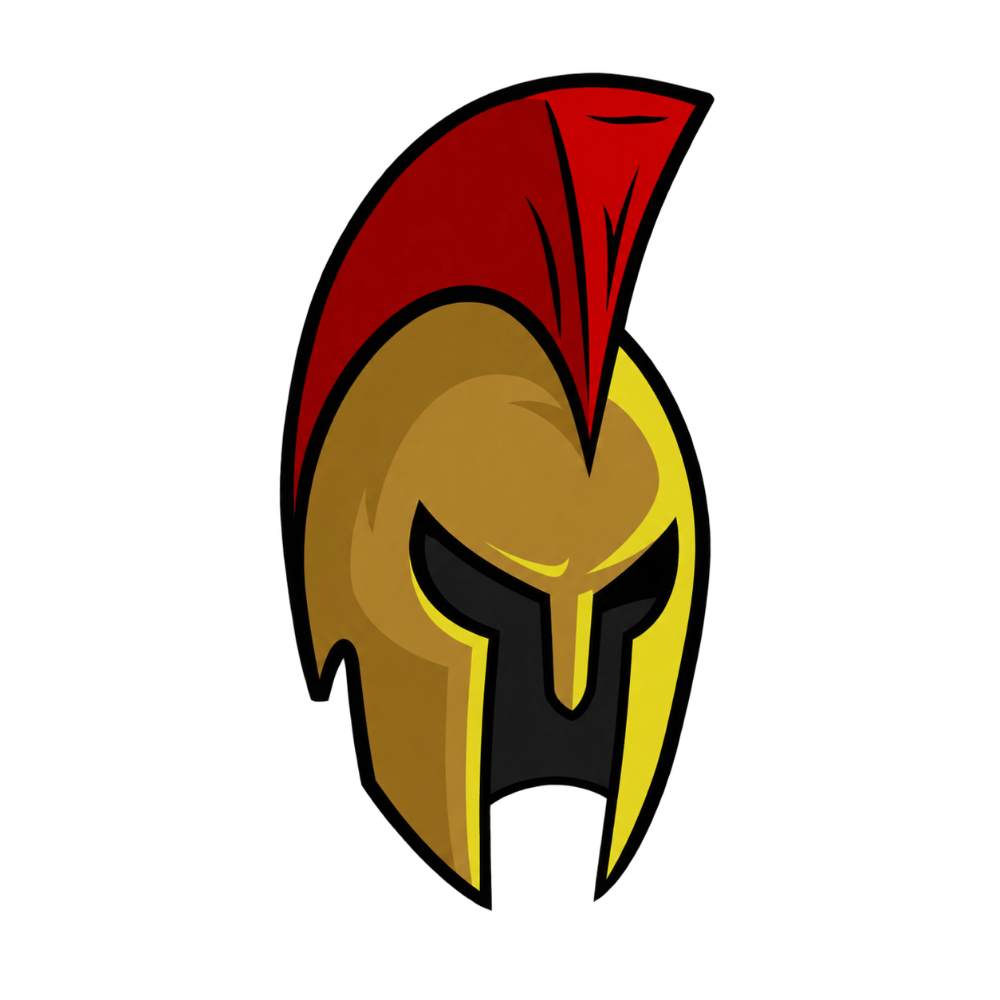

<p align="center">
  
</p>

<p align="center">
  <strong>A native port of Stick War 2. Work in progress.</strong><br>
  C++20 · Windows x64 · 16:9 presentation
</p>

<p align="center">
  <a href="https://github.com/JustPatrox/DeadWarrior-2/actions/workflows/windows.yml"></a>
  
  
  
</p>

<p align="center">
  <a href="#current-status">Status</a> ·
  <a href="#download-and-play">Download</a> ·
  <a href="#build-from-source">Build</a> ·
  <a href="#pc-controls">Controls</a> ·
  <a href="https://github.com/JustPatrox/DeadWarrior-2/issues/new/choose">Report a bug</a> ·
  <a href="CONTRIBUTING.md">Contribute</a>
</p>

## About

DeadWarrior 2 translates the game's logic into C++ and adapts its presentation to 16:9 displays. The executable uses Direct2D and XAudio2, with a software rendering fallback. The simulation runs at **30 Hz**, independently of the rendering frame rate.

The Windows download is a **native, ready-to-play port**: `DeadWarrior 2.exe` and its prepared `assets` folder. **No SWF, Flash Player, Java, Python, or emulator is needed to play.** The game runs its translated C++ controllers rather than loading the original SWF.

This project is not affiliated with Max Games or the original game's creators. See [credits and third-party content](NOTICE.md).

## Current status

**Development build: the full campaign has not been ported yet.** Six missions are accessible, through Massive Battle. Unimplemented sections display a work-in-progress screen with restart and quit options.

| Feature | Status |
| --- | --- |
| Menus, tutorial, and first six missions | Implemented; full parity is still under review |
| Campaign progress, upgrades, and saves | Implemented for the current content |
| 16:9 rendering, audio, and contextual cursors | Implemented |
| Windowed, borderless window, and fullscreen modes | Available in the Insert menu |
| 30 / 60 / 120 / 240 FPS or unlimited | Available |
| V-Sync, FPS counter, and render resolution | Available |
| Original campaign pause menu | MENU, Esc, or P |
| Persistent PC settings | Saved in `options.ini` |
| Remaining campaign and cutscenes | Pending |
| macOS and Linux | Pending; after Windows validation |

CI checks the Windows source build and Python tools. Gameplay tests require locally generated assets; a green CI result does not certify the full campaign.

## Download and play

**[Download the Windows development preview](https://github.com/JustPatrox/DeadWarrior-2/releases/tag/v0.0.0-preview.2)**

1. Download `DeadWarrior-2-Windows-x64.zip` from the release assets.
2. Extract the entire ZIP to a folder.
3. Run **`DeadWarrior 2.exe`**.

Keep the included `assets` folder next to the executable. This is an unfinished campaign preview, with the six missions listed above; it is not the complete game.

## Build from source

For the native Windows build, you need Git and **Visual Studio 2022 or 2026** with *Desktop development with C++* and CMake 3.24 or later. Copy the prepared `assets` folder from the Windows download into your checkout, then build:

```powershell
git clone https://github.com/JustPatrox/DeadWarrior-2.git
cd DeadWarrior-2
# Copy the release's assets folder into this directory before building.
.\tools\build_windows.ps1
& '.\out\windows-x64\DeadWarrior 2.exe'
```

See the [build guide](docs/building.md) for details. Preparing resources from an original SWF is an **optional developer workflow**, using Python, Java, and FFDec. Those tools are not part of the game runtime. The source tree keeps generated game resources out of Git; the Windows release includes everything needed to play.

## PC controls

| Key | Action |
| --- | --- |
| **Insert** | Open or close PC settings |
| **F11** | Toggle fullscreen |
| **Arrow keys / Tab** | Navigate PC settings |
| **Enter / Space** | Change the selected option |
| **Esc** | Close PC settings or pause/resume the battle |
| **P** | Pause/resume the battle |

Use **Insert → Show FPS → On** to display the counter in the top-left corner. Frame-rate settings affect presentation while preserving the simulation rate. The resolution selector offers Auto, 720p, 900p, 1080p, 1440p, and 2160p. PC settings are saved automatically in `%LOCALAPPDATA%\DeadWarrior 2\options.ini`; deleting a campaign save keeps these preferences.

## Reporting a problem

Open [a bug report](https://github.com/JustPatrox/DeadWarrior-2/issues/new?template=bug_report.yml) with reproduction steps, resolution, display mode, and version or commit. Attach **`lastest.log`** — that spelling is intentional. It is replaced on each launch and normally sits next to the executable. If that directory is not writable, it is stored in `%LOCALAPPDATA%\DeadWarrior 2`.

Review logs for personal paths before posting them. Do not attach the SWF, extracted resources, or saves containing information you do not want to share.

## Development

See [CONTRIBUTING.md](CONTRIBUTING.md), the [Windows guide](docs/windows.md), and the [translation traceability](docs/traceability.md). Simulation code lives in `src/campaign_*` and `src/tutorial_*`; `src/windows_*` handles the platform. Preparation and verification tools live in `tools/`.

<p align="center"><br><sub>DeadWarrior 2 · Work in progress</sub></p>
