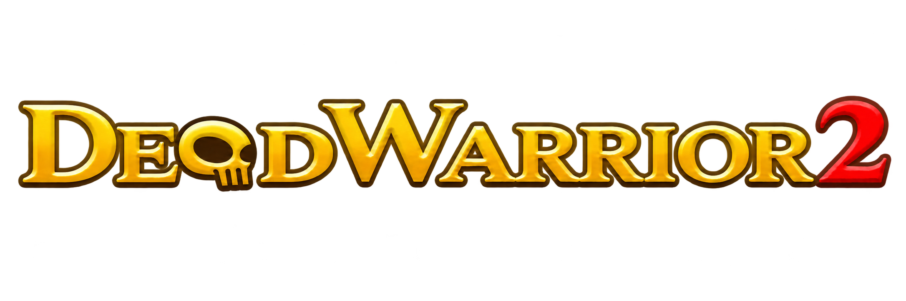

<p align="center">
  
</p>

<p align="center">
  <strong>Un port nativo de Stick War 2, en desarrollo.</strong><br>
  C++20 · Windows x64 · Presentación 16:9
</p>

<p align="center">
  <a href="https://github.com/JustPatrox/DeadWarrior-2/actions/workflows/windows.yml"></a>
  
  
  
</p>

<p align="center">
  <a href="#estado-actual">Estado</a> ·
  <a href="#compilar-y-jugar">Compilar</a> ·
  <a href="#controles-de-pc">Controles</a> ·
  <a href="https://github.com/JustPatrox/DeadWarrior-2/issues/new/choose">Reportar un fallo</a> ·
  <a href="CONTRIBUTING.md">Contribuir</a>
</p>

## El proyecto

DeadWarrior 2 traduce la lógica del juego a C++ y adapta su presentación a pantallas 16:9. El ejecutable usa Direct2D y XAudio2, con respaldo gráfico por software. La simulación avanza a **30 Hz**, independientemente de los FPS de presentación.

Cada usuario debe aportar su **propia copia de `stickwar2.swf`** para generar los recursos de su instalación. Este repositorio contiene el código y las herramientas de preparación; el SWF, sus scripts extraídos, sprites, música y efectos se mantienen fuera de Git.

Este proyecto no está afiliado con Max Games ni con los creadores del juego original. Consulta [los créditos y el contenido de terceros](NOTICE.md).

## Estado actual

**Versión de desarrollo: la campaña completa todavía no está portada.** Hay seis misiones accesibles, hasta Massive Battle. Los tramos pendientes muestran una pantalla de fin provisional con opciones para reiniciar o salir.

| Función | Estado |
| --- | --- |
| Menú, tutorial y primeras seis misiones | Implementados; paridad completa aún en revisión |
| Progreso, mejoras y guardado de campaña | Implementados para el contenido actual |
| Renderizado 16:9, audio y cursores contextuales | Implementados |
| Ventana, ventana sin bordes y pantalla completa | Disponibles desde Insert |
| Límite de 30 / 60 / 120 / 240 FPS o ilimitado | Disponible |
| V-Sync y contador de FPS | Disponibles |
| Campaña restante y cinemáticas | Pendientes |
| macOS y Linux | Pendientes; después de validar Windows |

La compilación automática comprueba el código de Windows y las herramientas Python. Las pruebas de partida necesitan los recursos generados localmente; un resultado verde de CI no certifica la campaña completa.

## Compilar y jugar

Necesitas Windows x64, Git, **Visual Studio 2022 o 2026** con el componente *Desarrollo para el escritorio con C++*, CMake 3.24 o superior, **Python 3.11**, **Java 21 x64** y **JPEXS FFDec 26.5.0**. Los enlaces y el procedimiento están en [la guía de compilación](docs/building.md).

```powershell
git clone https://github.com/JustPatrox/DeadWarrior-2.git
cd DeadWarrior-2
python -m venv work/venv
work/venv/Scripts/python.exe -m pip install -r requirements-assets.txt
```

Coloca tu SWF y las herramientas según [la guía](docs/building.md), y ejecuta:

```powershell
work/venv/Scripts/python.exe tools/prepare_assets.py --swf "C:\ruta\a\stickwar2.swf" --java-home "C:\ruta\a\java-21" --ffdec-home "C:\ruta\a\ffdec"
.\tools\build_windows.ps1
& '.\out\windows-x64\DeadWarrior 2.exe'
```

La preparación inicial extrae y genera miles de recursos; puede tardar. El ejecutable debe permanecer junto a su carpeta `assets`.

## Controles de PC

| Tecla | Acción |
| --- | --- |
| **Insert** | Abrir o cerrar los ajustes de PC |
| **F11** | Alternar pantalla completa |
| **Flechas / Tab** | Navegar por los ajustes de Insert |
| **Enter / Espacio** | Cambiar la opción seleccionada |
| **Esc** | Cerrar los ajustes |

En **Insert → Show FPS → On**, el contador aparece arriba a la izquierda. Las opciones de FPS cambian la presentación y conservan el ritmo de la simulación.

## Reportar un problema

Abre [un reporte de fallo](https://github.com/JustPatrox/DeadWarrior-2/issues/new?template=bug_report.yml) e indica cómo reproducirlo, tu resolución, modo de pantalla y versión o commit. Adjunta **`lastest.log`** —el nombre se escribe así—, que se reemplaza en cada arranque y normalmente está junto al ejecutable. Si esa carpeta no permite escritura, se guarda en `%LOCALAPPDATA%\DeadWarrior 2`.

Revisa el log antes de publicarlo por si contiene rutas personales. No adjuntes el SWF, recursos extraídos ni partidas con datos que no quieras compartir.

## Desarrollo

Consulta [CONTRIBUTING.md](CONTRIBUTING.md), [la guía de Windows](docs/windows.md) y [la trazabilidad de la traducción](docs/trazabilidad.md). El código de simulación está en `src/campaign_*` y `src/tutorial_*`; los módulos `src/windows_*` gestionan la plataforma. Las herramientas y comprobaciones están en `tools/`.

<p align="center"><br><sub>DeadWarrior 2 · Work in progress</sub></p>
